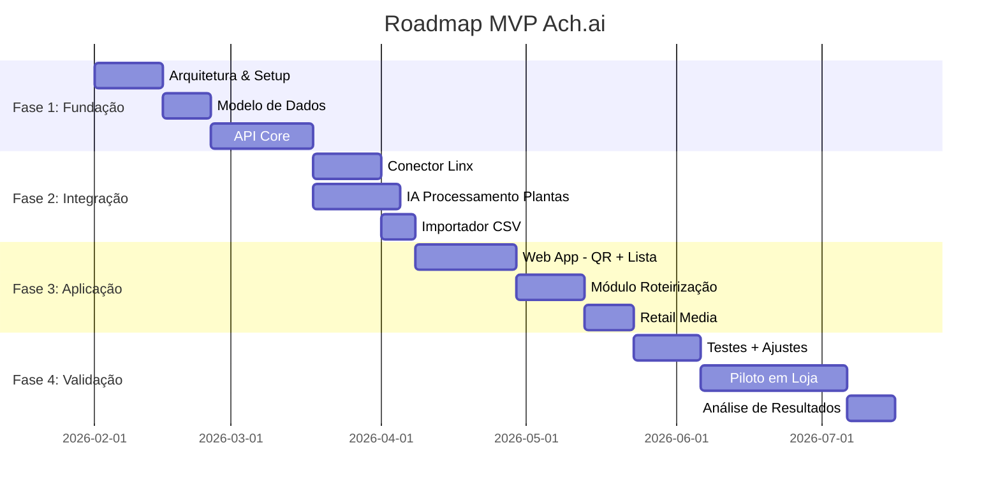

# 01. Visão Geral do Sistema

**Versão:** 1.0  
**Data:** Janeiro 2026  
**Status:** Draft  
**Autores:** Equipe Ach.ai - TCC FECAP 2026

---

## 1. Contexto e Problema

### 1.1 Problema de Negócio
Supermercados enfrentam desafios operacionais e comerciais relacionados à experiência de compra física:

- **Localização imprecisa**: Clientes não encontram produtos, gerando perda de venda e demanda ao time de piso
- **Ruptura não detectada**: Falta de estoque não é registrada em tempo real (só no PDV ao final)
- **Dados operacionais limitados**: Sistema de caixa registra venda, mas não a jornada de busca
- **Oportunidades de cross-sell**: Ofertas contextuais durante a compra não são exploradas

### 1.2 Solução Proposta
**Ach.ai** é uma plataforma de **navegação indoor** e **Retail Media** para supermercados que:

1. **QR Code no carrinho** → cliente acessa Web App sem instalar app
2. **Lista de compras inteligente** → busca no catálogo da filial com disponibilidade em tempo real
3. **Rota otimizada** → algoritmo TSP calcula menor caminho entre entrada, produtos e checkout
4. **Ofertas contextuais** → sugestões de produtos complementares por corredor (Retail Media)
5. **Analytics operacional** → registra buscas frustradas, "não encontrei", tempo de jornada

### 1.3 Proposta de Valor

#### Para o **Supermercado**:
- 📊 **Dados operacionais** sobre localização, ruptura e demanda não atendida
- 💰 **Nova fonte de receita** via Retail Media (ofertas patrocinadas)
- ⚡ **Redução de atrito** operacional (menos perguntas ao time de piso)
- 🎯 **Cross-sell inteligente** durante a jornada de compra

#### Para o **Cliente**:
- 🗺️ **Encontra produtos rapidamente** sem circular pela loja toda
- 💡 **Sugestões relevantes** de itens que combinam com sua lista
- ⏱️ **Economia de tempo** com rota otimizada

#### Para **Marcas/Indústria**:
- 📢 **Ponto de contato** durante a compra (momento de alta intenção)
- 🎯 **Segmentação contextual** por corredor e categoria
- 📈 **Mensuração** de impressões, cliques e adições ao carrinho

---

## 2. Objetivos e Escopo

### 2.1 Objetivos do MVP (Mínimo Produto Viável)

**Objetivo Principal:**  
Validar em **1 filial piloto** se clientes usam o fluxo de navegação e se os dados gerados são úteis para decisões operacionais.

**Objetivos Específicos:**
1. ✅ Acesso via QR Code sem instalação de app
2. ✅ Busca e montagem de lista com catálogo da filial
3. ✅ Cálculo de rota otimizada entre entrada, produtos e checkout
4. ✅ Exibição de ofertas contextuais (Retail Media)
5. ✅ Registro de eventos (buscas, rotas, reportes de "não encontrei")
6. ✅ Integração com ERP (Linx prioritário) para estoque e localização
7. ✅ IA para facilitar cadastro inicial da loja

### 2.2 Escopo do MVP

#### **IN SCOPE** ✅
- Web App PWA mobile-first (React + Tailwind CSS)
- API REST com PostgreSQL + PostGIS
- Integração com Linx (conector REST/SOAP)
- Importação CSV para fallback de sistemas legados
- IA para processar plantas baixas (OCR + LLM) e validar cadastro
- Mapeamento automático de localizações via atributos do ERP
- Algoritmo de roteirização (TSP com heurística de vizinho mais próximo)
- Ofertas contextuais baseadas em regras (não ML no MVP)
- Dashboard analytics básico (sessões, buscas, rotas, reportes)
- Modo visitante (sem necessidade de cadastro)

#### **OUT OF SCOPE** ❌ (Versões Futuras)
- Aplicativo nativo iOS/Android
- Posicionamento indoor contínuo (beacon/Wi-Fi triangulation)
- Machine Learning para recomendações personalizadas
- Multi-loja com gestão centralizada
- Gamificação e fidelidade
- Integração com pagamento digital
- Modo offline completo
- Sincronização bidirecional com ERP (só leitura no MVP)

### 2.3 Métricas de Sucesso (MVP)

#### **Adoção:**
- 📱 **30%** dos clientes escaneiam o QR Code (do total que passa pela entrada)
- 📝 **50%** dos que escaneiam completam uma lista (≥3 produtos)
- 🗺️ **40%** dos que criam lista seguem a rota calculada

#### **Operacional:**
- 🔍 **80%** das buscas encontram produto no catálogo
- ❌ **<5%** de reportes "não encontrei" para produtos com estoque>0
- ⏱️ **<3s** tempo de carregamento inicial do Web App (RNF20)
- 🧮 **<2s** cálculo de rota para até 50 produtos (RNF28)

#### **Comercial (Retail Media):**
- 👁️ Taxa de impressão de ofertas contextuais: **>60%** das rotas
- 👆 Taxa de clique em ofertas: **>8%** das impressões
- ➕ Taxa de adição de recomendações: **>3%** dos cliques

---

## 3. Stakeholders

| Papel | Responsabilidades | Expectativas |
|-------|-------------------|--------------|
| **Supermercado (Gerente de Loja)** | Autorizar piloto, fornecer dados, validar mapa | Reduzir demanda operacional, insights sobre ruptura |
| **Supermercado (TI)** | Liberar acesso ao ERP, revisar segurança | Integração não intrusiva, sem impactar performance |
| **Cliente Final** | Usar o Web App durante compra | Encontrar produtos rapidamente, ofertas relevantes |
| **Marcas/Indústria** | Patrocinar ofertas contextuais | ROI positivo em campanhas, mensuração confiável |
| **Equipe Ach.ai** | Desenvolver, implantar, suportar | Validar PMF, aprender com dados reais |

---

## 4. Glossário

| Termo | Definição |
|-------|-----------|
| **Filial** | Ponto de venda físico (loja) de uma rede de supermercados |
| **SKU** | Stock Keeping Unit - identificador único de produto |
| **Grafo da loja** | Representação matemática dos corredores e conexões entre pontos |
| **Nó** | Ponto no grafo (entrada, checkout, posição de produto) |
| **Aresta** | Conexão entre dois nós (caminho possível) |
| **TSP** | Traveling Salesman Problem - problema do caixeiro viajante |
| **Heurística** | Algoritmo aproximado que encontra solução boa (não necessariamente ótima) |
| **Retail Media** | Publicidade contextual no ponto de venda |
| **Oferta contextual** | Sugestão de produto baseada na localização/categoria da rota |
| **Evento de busca** | Registro de tentativa de encontrar produto no catálogo |
| **Reporte de ausência** | Cliente informa que não encontrou produto (apesar de constar no sistema) |
| **Mix de produtos** | Conjunto de SKUs disponíveis em uma filial específica |
| **Ruptura** | Falta de estoque de produto que deveria estar disponível |
| **PWA** | Progressive Web App - aplicação web que funciona como app nativo |

---

## 5. Premissas e Restrições

### 5.1 Premissas
- ✅ Supermercado possui catálogo digital (ERP ou CSV exportável)
- ✅ Produtos têm identificadores únicos (EAN/GTIN ou código interno)
- ✅ Loja fornece planta baixa ou permite mapeamento presencial
- ✅ Conexão de internet estável na loja (Wi-Fi ou 4G/5G)
- ✅ QR Codes impressos/fixados em carrinhos de compra

### 5.2 Restrições Técnicas
- 🔒 **Sem acesso a dados sensíveis do cliente final** (CPF, histórico de compra)
- 🔒 **Integração ERP é read-only** no MVP (não escreve de volta)
- ⏱️ **Processamento de IA** para plantas baixas pode levar minutos (não é real-time)
- 📱 **Web App funciona em navegadores modernos** (Chrome 90+, Safari 14+, Firefox 88+)
- 🗺️ **Mapa 2D simplificado** (não usa 3D ou realidade aumentada)

### 5.3 Restrições de Negócio
- 💰 **Precificação exibida apenas** para ofertas patrocinadas/promoções autorizadas
- 📊 **Dados agregados** (não identifica cliente individualmente)
- 🕐 **Horário de funcionamento** limitado ao horário da loja
- 🏢 **Piloto em 1 filial** antes de expansão

---

## 6. Cronograma de Alto Nível

**Duração Total Estimada:** ~6 meses (incluindo piloto de 1 mês)

---

## 7. Próximos Passos

1. ✅ **Revisar e aprovar** esta especificação com stakeholders
2. 📋 **Detalhar requisitos** funcionais e não-funcionais (specs 03-05)
3. 🗄️ **Modelar banco de dados** e schemas (specs 06-07)
4. 🔌 **Especificar APIs** e integrações (specs 08-10)
5. 🚀 **Iniciar desenvolvimento** seguindo arquitetura definida

---

**Aprovações Necessárias:**
- [ ] Gerente de Produto
- [ ] Arquiteto de Software  
- [ ] Orientador Acadêmico (Prof. Leonardo Lugoboni)
- [ ] Supermercado Piloto (após seleção)

---

**Próximo:** [02. Arquitetura do Sistema](./02-arquitetura-sistema.md)
