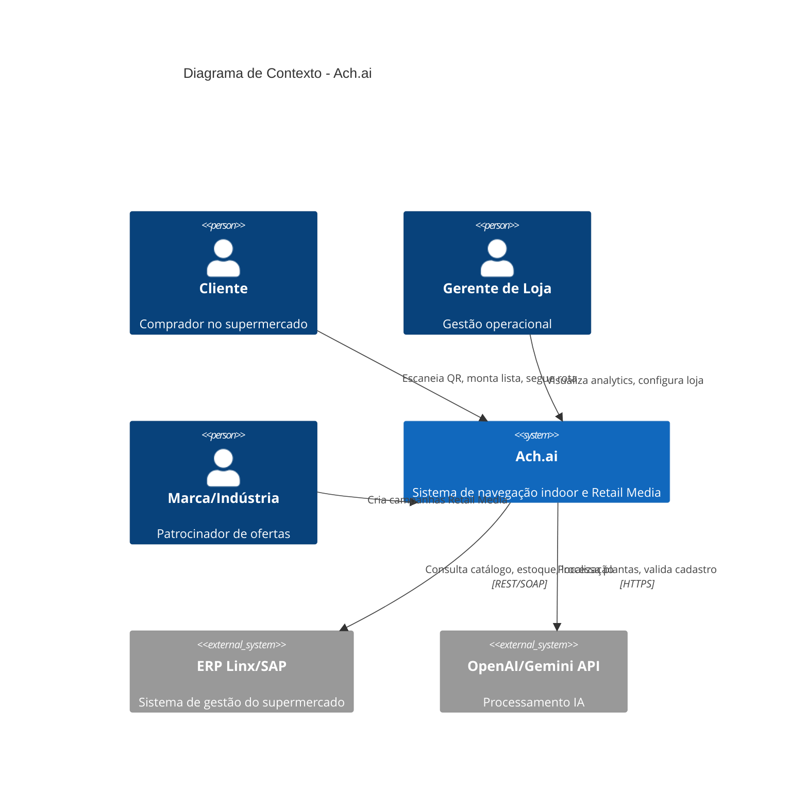
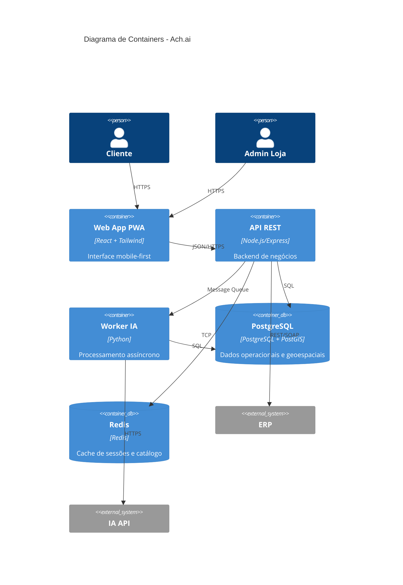
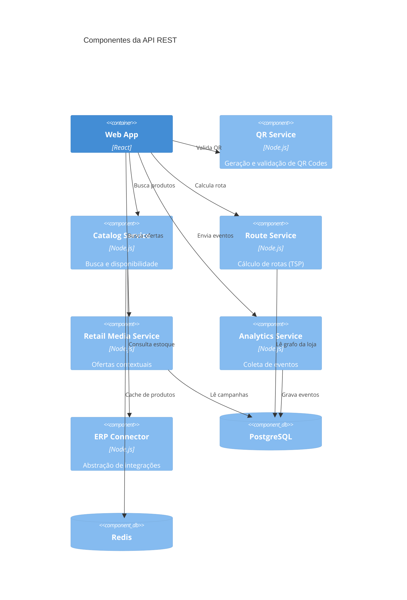
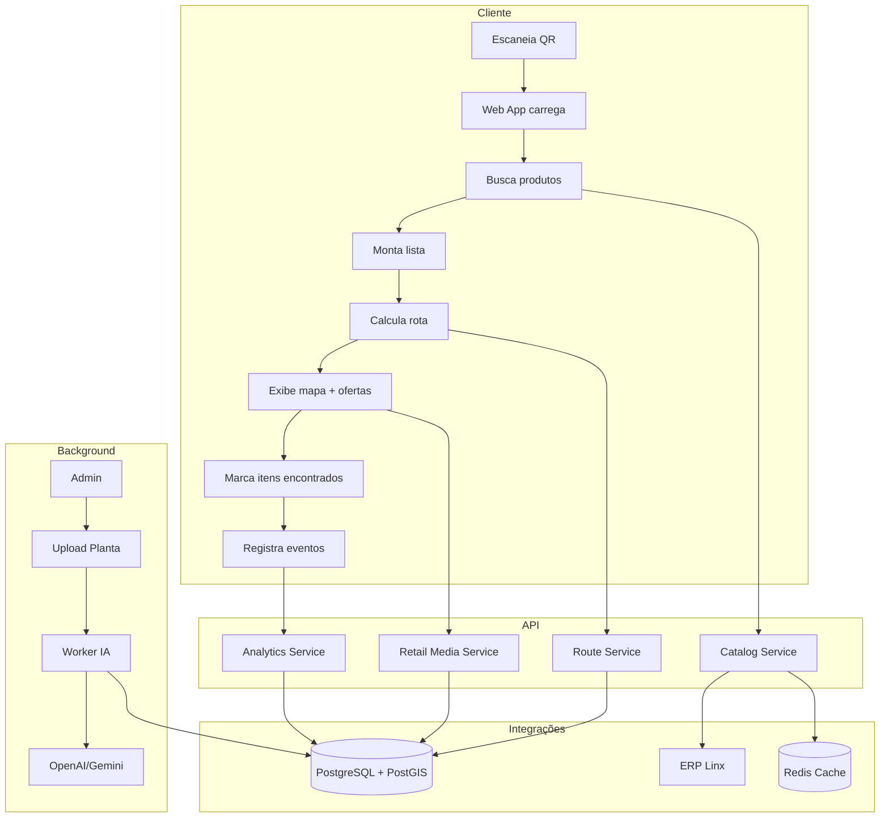

# 02. Arquitetura do Sistema

**Versão:** 1.0  
**Responsável:** Arquiteto de Software  
**Status:** Draft

---

## 1. Visão Arquitetural (C4 Model)

### 1.1 Contexto (Nível 1)



### 1.2 Containers (Nível 2)



### 1.3 Componentes - API (Nível 3)



---

## 2. Decisões Arquiteturais (ADRs)

### ADR-001: Web App PWA vs App Nativo

**Status:** Aceito  
**Contexto:** Necessidade de acesso rápido via QR sem instalação  
**Decisão:** Progressive Web App (PWA) com React  
**Consequências:**
- ✅ Sem barreira de instalação
- ✅ Manutenção unificada (1 codebase)
- ✅ Deploy contínuo sem app store review
- ⚠️ Funcionalidades offline limitadas
- ⚠️ Sem push notifications nativas no iOS

### ADR-002: PostgreSQL + PostGIS vs MongoDB

**Status:** Aceito  
**Contexto:** Necessidade de consultas geoespaciais (grafos, distâncias)  
**Decisão:** PostgreSQL com extensão PostGIS  
**Consequências:**
- ✅ ACID garantido para transações críticas
- ✅ PostGIS maduro para queries espaciais
- ✅ Suporte a grafos (via extensões)
- ⚠️ Menos flexível para schemas dinâmicos

### ADR-003: API REST Síncrona vs Event-Driven

**Status:** Aceito (MVP), Revisão futura  
**Contexto:** Simplicidade vs escalabilidade  
**Decisão:** API REST síncrona no MVP, preparar para eventos  
**Consequências:**
- ✅ Desenvolvimento mais rápido
- ✅ Debug simplificado
- ⚠️ Pode ser gargalo em alto volume
- 💡 Preparar mensageria (RabbitMQ/SQS) para fase 2

### ADR-004: Integração ERP - Conectores Diretos vs Middleware

**Status:** Aceito  
**Contexto:** Múltiplos ERPs no mercado  
**Decisão:** Camada de abstração com conectores específicos  
**Consequências:**
- ✅ Facilita adição de novos ERPs
- ✅ Testes isolados por conector
- ⚠️ Overhead de manutenção por conector

### ADR-005: IA - Modelo Próprio vs API Externa

**Status:** Aceito (MVP)  
**Contexto:** OCR de plantas e validação inteligente  
**Decisão:** OpenAI/Gemini API no MVP, reavaliar com dados  
**Consequências:**
- ✅ Rápido de implementar
- ✅ Sem custo de treino inicial
- ⚠️ Custo por requisição
- ⚠️ Dependência de serviço externo
- 💡 Considerar fine-tuning futuro

### ADR-006: Autenticação - Modo Visitante vs Obrigatória

**Status:** Aceito  
**Contexto:** Fricção vs personalização  
**Decisão:** Modo visitante no MVP, login opcional  
**Consequências:**
- ✅ Sem barreira de entrada
- ⚠️ Sem histórico de compra personalizado
- 💡 Incentivar login com benefícios (listas salvas)

---

## 3. Stack Tecnológica Detalhada

### 3.1 Frontend (Web App)

| Camada | Tecnologia | Justificativa |
|--------|------------|---------------|
| **Framework** | React 18+ | Ecossistema maduro, performance, PWA support |
| **Estilização** | Tailwind CSS | Utility-first, mobile-first, customizável |
| **Estado** | Zustand / Jotai | Simples, menos boilerplate que Redux |
| **Roteamento** | React Router v6 | Padrão de mercado |
| **HTTP Client** | Axios | Interceptors, retry logic |
| **Maps** | Leaflet.js / SVG custom | Mapas 2D customizáveis |
| **Build** | Vite | Rápido, ESM nativo, HMR |
| **PWA** | Vite PWA Plugin | Service Worker, manifest, offline |

### 3.2 Backend (API REST)

| Camada | Tecnologia | Justificativa |
|--------|------------|---------------|
| **Runtime** | Node.js 20 LTS | Non-blocking I/O, ecossistema npm |
| **Framework** | Express.js | Minimalista, extensível, maduro |
| **Validação** | Zod | Type-safe schemas |
| **ORM** | Prisma / Drizzle | Type-safe, migrations, geração de tipos |
| **Autenticação** | JWT + Passport.js | Stateless, extensível |
| **Rate Limiting** | express-rate-limit | Proteção DDoS |
| **Logging** | Winston + Morgan | Estruturado, níveis configuráveis |
| **Docs** | Swagger / OpenAPI | Auto-gerado, interativo |

### 3.3 Worker IA (Processamento Assíncrono)

| Camada | Tecnologia | Justificativa |
|--------|------------|---------------|
| **Runtime** | Python 3.11+ | Ecossistema IA/ML |
| **Framework** | FastAPI | Async, validação automática, docs |
| **OCR** | OpenAI Vision API | State-of-the-art, multi-modal |
| **Validação** | GPT-4 / Gemini Pro | Reasoning sobre dados estruturados |
| **Queue** | BullMQ (Node) / Celery (Python) | Retry, scheduling, monitoring |

### 3.4 Banco de Dados

| Componente | Tecnologia | Justificativa |
|------------|------------|---------------|
| **Relacional** | PostgreSQL 16 | ACID, extensões, performance |
| **Geoespacial** | PostGIS 3.4 | Queries espaciais, grafos |
| **Cache** | Redis 7 | Pub/sub, cache distribuído |
| **Busca** | PostgreSQL Full-Text | Built-in, suficiente para MVP |

### 3.5 Infraestrutura

| Componente | Opção 1 (AWS) | Opção 2 (Azure) | Opção 3 (GCP) |
|------------|---------------|-----------------|---------------|
| **Compute** | ECS Fargate | Container Apps | Cloud Run |
| **Database** | RDS PostgreSQL | PostgreSQL Flex | Cloud SQL |
| **Cache** | ElastiCache Redis | Azure Cache | Memorystore |
| **Storage** | S3 | Blob Storage | Cloud Storage |
| **CDN** | CloudFront | Azure CDN | Cloud CDN |
| **Monitoring** | CloudWatch | Application Insights | Cloud Monitoring |
| **CI/CD** | GitHub Actions + CodePipeline | Azure DevOps | Cloud Build |

---

## 4. Padrões de Comunicação

### 4.1 API REST (Sync)

```
Client (Web App) → API Gateway → Service → Database
                                        → Cache
                                        → External API
```

**Características:**
- Request/Response síncrono
- HTTP/1.1 ou HTTP/2
- JSON payload
- Timeout: 30s (search), 5s (read), 10s (write)

### 4.2 Mensageria (Async - Fase 2)

```
API → Message Queue → Worker → Database
                              → External API
                              → Notification
```

**Casos de uso:**
- Processamento IA de plantas (long-running)
- Sincronização bulk de catálogo
- Geração de relatórios

### 4.3 WebSocket (Opcional - Fase 3)

```
Client ↔ WebSocket Server → Event Bus → Services
```

**Casos de uso:**
- Atualização de disponibilidade em tempo real
- Notificações push de ofertas

---

## 5. Estratégia de Deployment

### 5.1 Ambientes

| Ambiente | Propósito | Deploy | Dados |
|----------|-----------|--------|-------|
| **Local** | Desenvolvimento | Docker Compose | Mock / Seed |
| **Dev** | Integração contínua | Auto (push to main) | Anonymized |
| **Staging** | QA / Homologação | Manual (aprovação PO) | Prodlike |
| **Production** | Clientes reais | Manual (aprovação + checklist) | Real |

### 5.2 Rollout Strategy

**Blue-Green Deployment:**
1. Deploy nova versão (Green) em paralelo
2. Smoke tests automáticos
3. Redireciona 10% do tráfego (canary)
4. Monitora métricas (5min)
5. Se OK → 100% para Green, desliga Blue
6. Se ERRO → Rollback instantâneo para Blue

### 5.3 Disaster Recovery

- **RTO** (Recovery Time Objective): 1h
- **RPO** (Recovery Point Objective): 5min (replicação contínua)
- **Backup:** Diário completo + WAL contínuo (PostgreSQL)
- **Multi-AZ:** Database em 2 zonas de disponibilidade

---

## 6. Diagrama de Fluxo de Dados



---

## 7. Segurança em Camadas

```
┌─────────────────────────────────────────┐
│ WAF (AWS WAF / Cloudflare)              │ ← DDoS, SQL Injection
├─────────────────────────────────────────┤
│ API Gateway (Rate Limiting)             │ ← Throttling por IP
├─────────────────────────────────────────┤
│ Load Balancer (TLS 1.3)                 │ ← HTTPS obrigatório
├─────────────────────────────────────────┤
│ Application (Input Validation)          │ ← Zod schemas
├─────────────────────────────────────────┤
│ Business Logic (Authorization)          │ ← RBAC, ABAC
├─────────────────────────────────────────┤
│ Data Layer (Encryption at Rest)         │ ← AES-256
└─────────────────────────────────────────┘
```

**Certificações alvo:** ISO 27001, SOC 2 Type II (Fase 3)

---

## 8. Monitoramento e Observabilidade

### 8.1 Métricas (Golden Signals)

| Sinal | Métrica | Target | Alerta |
|-------|---------|--------|--------|
| **Latency** | p95 response time | <500ms | >1s |
| **Traffic** | Requests/s | N/A | Spike >300% |
| **Errors** | Error rate | <0.1% | >1% |
| **Saturation** | CPU/Memory usage | <70% | >85% |

### 8.2 Logs Estruturados

```json
{
  "timestamp": "2026-01-15T14:32:10.123Z",
  "level": "info",
  "service": "catalog-service",
  "trace_id": "abc123",
  "user_id": "anonymous",
  "filial_id": "loja-001",
  "action": "search_product",
  "query": "arroz",
  "results": 12,
  "duration_ms": 45
}
```

### 8.3 Distributed Tracing

**OpenTelemetry:**
- Span por requisição HTTP
- Trace através de microsserviços
- Integração com Jaeger/Zipkin

---

## 9. Escalabilidade

### 9.1 Horizontal Scaling

| Componente | Scaling Trigger | Min | Max |
|------------|-----------------|-----|-----|
| **API** | CPU >70% | 2 | 10 |
| **Worker IA** | Queue depth >100 | 1 | 5 |
| **Database** | Read replicas | 1 master + 1 replica | 1 master + 3 replicas |
| **Cache** | Memory >80% | 1 node | 3 node cluster |

### 9.2 Performance Targets

| Cenário | Target | Medição |
|---------|--------|---------|
| Carregamento inicial | <3s | Lighthouse Performance >90 |
| Busca de produto | <300ms | p95 latency |
| Cálculo de rota (10 itens) | <500ms | p95 latency |
| Cálculo de rota (50 itens) | <2s | p99 latency (RNF-028) |
| Throughput API | >1000 req/s | Load test (K6) |

---

## 10. Custo Estimado (MVP - 1 Loja)

| Item | Serviço | Custo Mensal (USD) |
|------|---------|-------------------|
| Compute | 2x ECS Fargate (0.5 vCPU) | $30 |
| Database | RDS t4g.medium (2vCPU, 4GB) | $60 |
| Cache | ElastiCache t4g.micro | $12 |
| Storage | S3 (100GB) + CloudFront | $15 |
| IA API | OpenAI API (~10k calls) | $50 |
| Monitoring | CloudWatch + Logs | $20 |
| **Total** | | **~$187/mês** |

**Nota:** Custo aumenta com número de lojas (~$50/loja adicional)

---

## 11. Roadmap Técnico

### MVP (6 meses)
- ✅ Arquitetura base (containers, database, API)
- ✅ Web App PWA
- ✅ Integração Linx
- ✅ Roteirização TSP
- ✅ Retail Media básico
- ✅ Analytics operacional

### Fase 2 (6-12 meses)
- 🔄 Event-driven architecture (mensageria)
- 🔄 Multi-loja (gestão centralizada)
- 🔄 ML para recomendações personalizadas
- 🔄 Integração SAP
- 🔄 Dashboard analytics avançado

### Fase 3 (12-18 meses)
- 🔮 App nativo iOS/Android
- 🔮 Posicionamento indoor (BLE beacons)
- 🔮 WebSocket para updates real-time
- 🔮 Integração pagamento digital
- 🔮 Gamificação

---

## 12. Referências Técnicas

- [C4 Model](https://c4model.com/)
- [ADR (Architecture Decision Records)](https://adr.github.io/)
- [12 Factor App](https://12factor.net/)
- [PostgreSQL + PostGIS Docs](https://postgis.net/)
- [OpenTelemetry](https://opentelemetry.io/)
- [OWASP Top 10](https://owasp.org/Top10/)

---

**Anterior:** [01. Visão Geral](./01-visao-geral.md)  
**Próximo:** [03. Requisitos Funcionais](./03-requisitos-funcionais.md)
