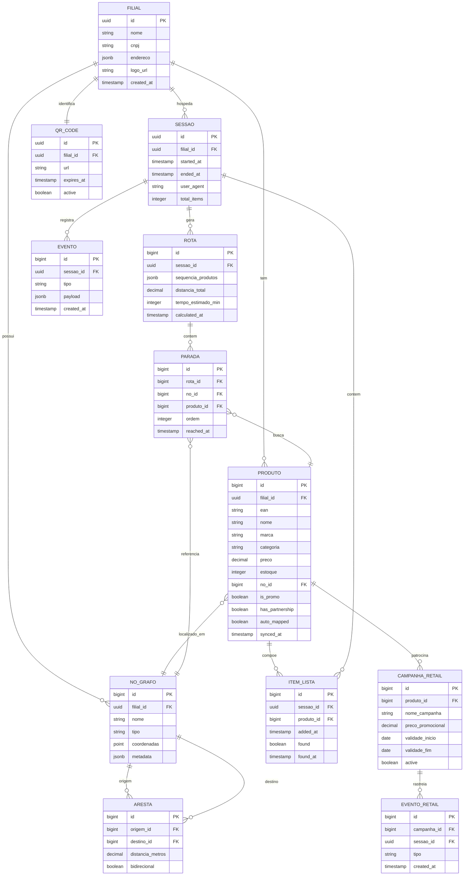

# 06. Modelo de Dados

**Versão:** 1.0  
**Responsável:** Arquiteto de Dados  
**Status:** Draft

---

## 1. Diagrama ER (Entidade-Relacionamento)



---

## 2. Descrição das Entidades

### 2.1 FILIAL
Representa um ponto de venda (loja) da rede de supermercados.

**Relacionamentos:**
- 1:N com PRODUTO (catálogo da filial)
- 1:N com NO_GRAFO (layout da loja)
- 1:1 com QR_CODE (identificação)

---

### 2.2 PRODUTO
Itens do catálogo da filial, sincronizados com ERP.

**Índices:**
- `idx_produto_filial_ean` (filial_id, ean) UNIQUE
- `idx_produto_busca` GIN (to_tsvector('portuguese', nome || ' ' || marca))

---

### 2.3 NO_GRAFO
Pontos de interesse no mapa da loja (entrada, checkout, posições de produtos).

**Tipos de nó:**
- `entrada`: Ponto de entrada
- `checkout`: Caixa
- `corredor`: Corredor genérico
- `produto`: Posição específica de produto

**Campo `coordenadas`:** PostGIS POINT (x, y)

---

### 2.4 ARESTA
Conexões entre nós (caminhos possíveis).

**Propriedades:**
- `distancia_metros`: Calculada via ST_Distance
- `bidirecional`: Se true, pode ir A→B e B→A

---

### 2.5 SESSAO
Uso do Web App por um cliente (anônimo).

**Ciclo de vida:**
1. Criada ao escanear QR
2. Ativa durante compra
3. Fechada após 30min inatividade OU conclusão

---

### 2.6 ROTA
Resultado do cálculo de roteirização (TSP).

**Campo `sequencia_produtos`:** Array JSON com IDs ordenados
```json
{
  "produtos": [123, 456, 789],
  "nos": [10, 15, 22],
  "heuristica": "nearest_neighbor"
}
```

---

### 2.7 EVENTO
Registro genérico de ações do usuário.

**Tipos de evento:**
- `qr_scan`: Escaneou QR
- `search`: Buscou produto
- `add_to_list`: Adicionou item
- `calculate_route`: Calculou rota
- `item_found`: Marcou item como encontrado
- `item_not_found`: Reportou "não encontrei"

**Campo `payload`:** JSON flexível com detalhes

---

### 2.8 EVENTO_RETAIL
Métricas específicas de Retail Media.

**Tipos:**
- `impression`: Oferta exibida
- `click`: Oferta clicada
- `conversion`: Oferta adicionada à lista

---

## 3. Schemas SQL Completos

Ver arquivo: [`exemplos/schema.sql`](./exemplos/schema.sql)

---

## 4. Estratégias de Otimização

### 4.1 Particionamento
Tabela `evento` particionada por mês:
```sql
CREATE TABLE evento_2026_01 PARTITION OF evento
FOR VALUES FROM ('2026-01-01') TO ('2026-02-01');
```

### 4.2 Índices Geoespaciais
```sql
CREATE INDEX idx_no_grafo_coords ON no_grafo USING GIST (coordenadas);
```

### 4.3 Cache Redis
Estruturas cacheadas:
- Catálogo por filial (TTL 10min)
- Grafo da loja (TTL 1h)
- Disponibilidade de produtos (TTL 5min)

---

**Anterior:** [05. Regras de Negócio](./05-regras-negocio.md)  
**Próximo:** [07. Dicionário de Dados](./07-dicionario-dados.md)
